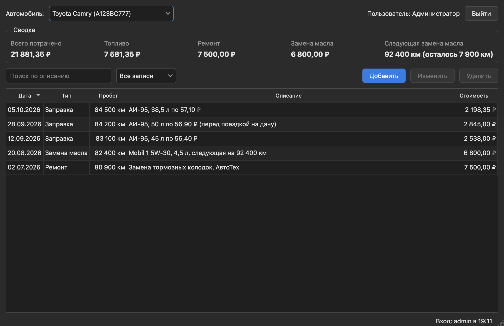
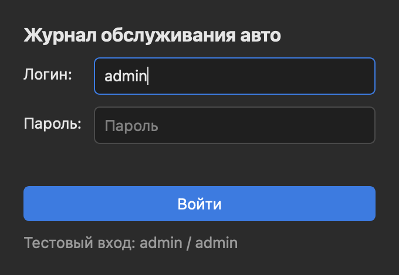
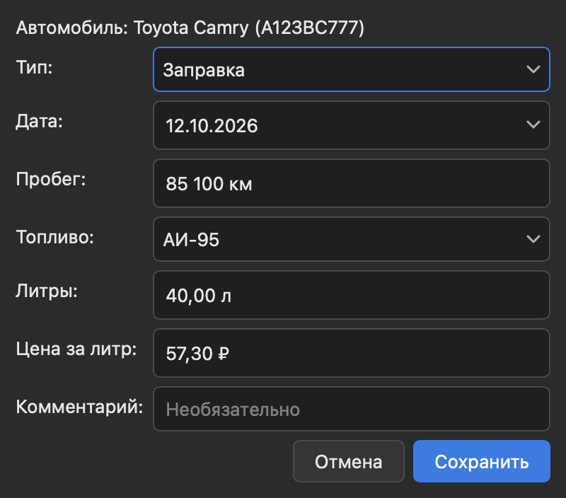

# Журнал обслуживания автомобиля

Зачётная работа по ООП. Программа для учёта заправок, ремонтов и замены масла, написана на Python + PySide6.

## Как запустить

```
pip install -r requirements.txt
python main.py
```

Логин и пароль для входа: admin / admin (или student / oop2026).

После закрытия программы в папке появляется файл report.txt с отчётом о входах пользователей.

## Что есть в программе

- несколько машин, у каждой свой журнал
- записи трёх типов: заправка, ремонт, замена масла
- добавление, изменение и удаление записей
- поиск и фильтр по типу
- сортировка таблицы по любому столбцу
- сводка: сколько всего потрачено и когда менять масло

## Скриншоты

Главное окно:



Вход и добавление записи:



